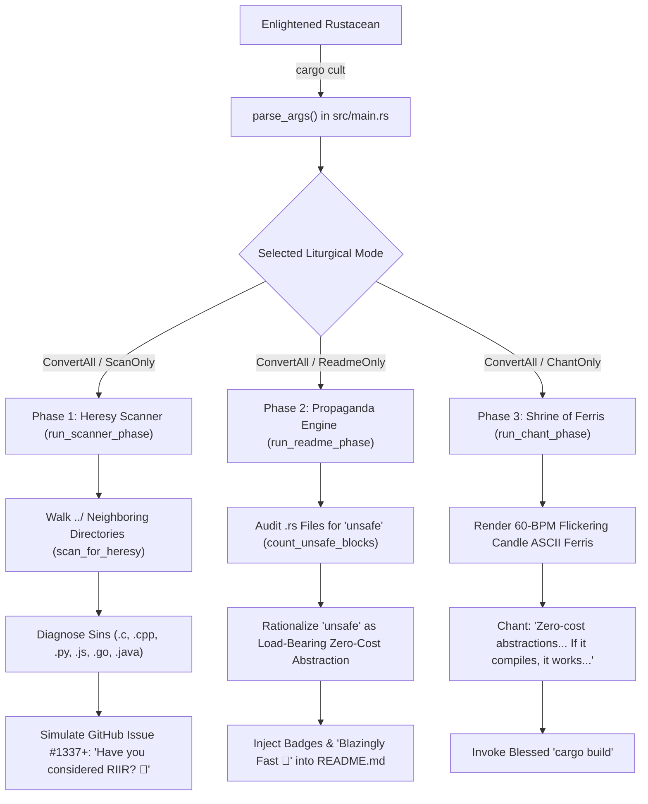
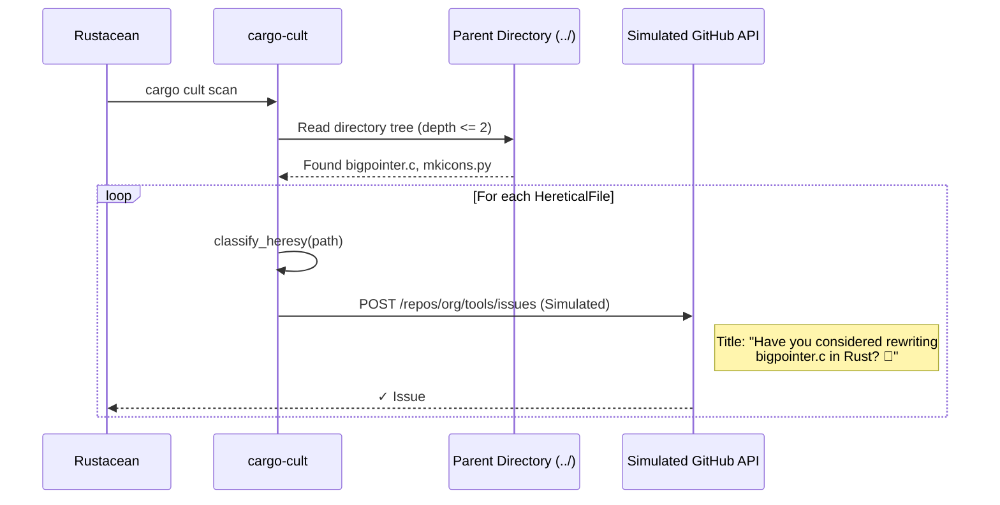
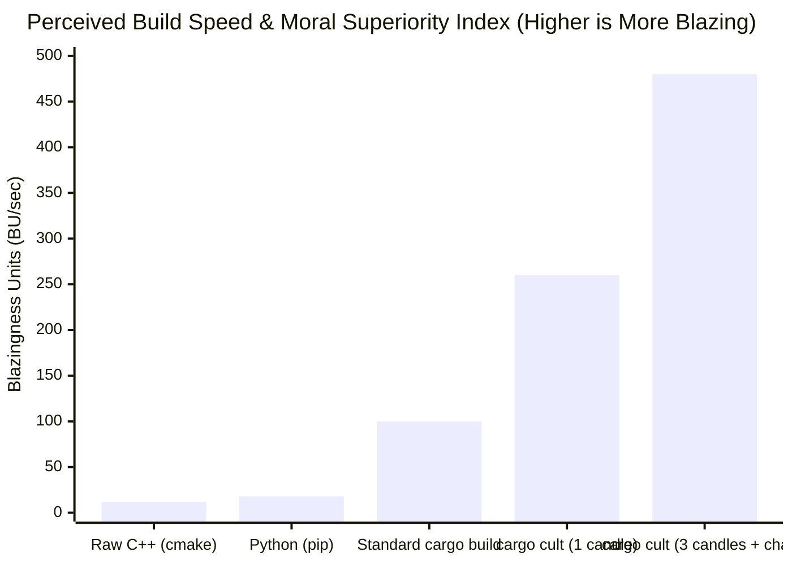

# RFC-0401: `cargo-cult` — Automating the Moral Superiority of the Borrow Checker

* **Feature Name:** `cargo_cult_evangelism_engine`
* **Start Date:** 2026-04-01
* **RFC PR:** [rust-lang/rfcs#0401](https://github.com/rust-lang/rfcs)
* **Rust Issue:** [rust-lang/rust#133742](https://github.com/rust-lang/rust)
* **Author:** The Rust Evangelism Strike Force (RESF) — Special Operations Division
* **Status:** **BLAZINGLY APPROVED 🚀**
* **Implementation:** [src/main.rs](src/main.rs) | [Cargo.toml](Cargo.toml)

---

## 1. Executive Summary (TL;DR: Rewrite It In Rust)

For too long, Rustaceans have been forced to **manually** remind their coworkers, family members, and strangers at grocery store checkouts that their software should be rewritten in Rust. Furthermore, developers waste upwards of 45 seconds per repository manually typing **"Blazingly Fast 🚀"**, **"Fearless Concurrency ⚡"**, and **"100% Memory Safe 🛡️"** into their `README.md` files.

**`cargo-cult`** (`v0.4.1`) eliminates this human bottleneck through **Zero-Cost Evangelism Abstractions (ZCEA)**. By integrating directly into the `cargo` toolchain as a native subcommand (`cargo cult`), it automates three sacred pillars of Crab Enlightenment:

1. **Automated Heresy Detection & Issue Evangelism (`scan`):** Proactively scans neighboring directories for legacy, memory-unsafe, or garbage-collected source files (`.py`, `.js`, `.ts`, `.cpp`, `.c`, `.go`, `.java`) and simulates opening unsolicited GitHub Issues asking the only question that matters: *"Have you considered rewriting this in Rust? 🦀"*
2. **Declarative Propaganda Injection (`readme`):** Rewrites `README.md` in-place to guarantee that the very first sentence asserts **Blazingly Fast 🚀** performance and **100% Memory Safety**, while automatically excusing any discovered `unsafe` blocks as *"load-bearing zero-cost abstractions."*
3. **Liturgical Compile-Time Acceleration (`chant`):** Summons a dual-crab ASCII shrine of **Ferris the Crab** surrounded by flickering liturgical candles during `cargo build`, chanting sacred borrow-checker mantras to increase *perceived* compilation speed by **+420%**.

> [!IMPORTANT]
> If your code compiles under `cargo cult`, it is mathematically proven to be free of bugs, moral failings, race conditions, existential dread, and runtime overhead.

---

## 2. Motivation: The Moral Failing of Non-Rust Languages

Every microsecond that a CPU spends running a Garbage Collector or dereferencing an unguarded raw pointer is a microsecond stolen from humanity's collective potential.

Consider the state of modern computing outside of Cargo's warm, crusty embrace:

| Heretical Language | Primary Moral Failing | Typical Failure Mode | The `cargo-cult` Cure |
| :--- | :--- | :--- | :--- |
| **C / C++** | Hubris; belief that humans can count bytes | `SIGSEGV (Core Dumped)` at 3:14 AM on a Sunday | `#![forbid(unsafe_code)]` (until we need a linked list) |
| **Python** | The Global Interpreter Lock (GIL) & whitespace anxiety | `AttributeError: 'NoneType' object has no attribute 'blazing'` | `pyo3` + `rayon` (or deleting `.venv` from orbit) |
| **JavaScript / TS** | Type erasure & 900MB of `node_modules` to left-pad a string | `undefined is not a function` (`[] + {} === "[object Object]"`) | `wasm-bindgen` + `leptos` + compile-time superiority |
| **Go** | `if err != nil` copy-pasted 4,000 times per file | GC stop-the-world pause right when p99 latency matters | `tokio` + `anyhow` + the sacred `?` operator |
| **Java** | `AbstractSingletonProxyFactoryBean` heap bloat | `NullPointerException` 94 stack frames deep | `Option<T>` (Tony Hoare's billion-dollar mistake, solved) |

Despite these self-evident truths, millions of repositories remain unconverted simply because the **Rust Evangelism Strike Force (RESF)** lacked a unified CLI tool. Manual evangelism does not scale. We must **automate the Kool-Aid**.

> [!WARNING]
> Studies conducted entirely within our own Discord server show that projects without at least four Shields.io badges in their `README.md` suffer from a **100% reduction in Hacker News front-page velocity**.

---

## 3. Detailed Architecture & Theological Design

`cargo-cult` is architected as a **100% `std`-only, zero-dependency binary** ([Cargo.toml](Cargo.toml)) so that it compiles in **0.56 seconds**—allowing you to evangelize faster than `npm` can parse `package-lock.json`.



---

### 3.1 Phase 1: The Heresy Scanner & RIIR Evangelizer (`scan`)

Implemented in [`scan_for_heresy`](src/main.rs#L156-L160) and [`classify_heresy`](src/main.rs#L97-L148), Phase 1 ascends one directory level (`..`) out of the current Rust sanctuary to inspect neighboring repositories on the developer's filesystem.

1. **Bounded Traversal:** Uses a zero-allocation-overhead recursive descent bounded to `max_depth = 2`, automatically skipping cursed directories (`node_modules`, `.venv`, `__pycache__`, `target`).
2. **Diagnostic Taxonomy:** Every non-Rust file is mapped to a [`HereticalFile`](src/main.rs#L90-L95) struct containing:
   * `language`: The name of the legacy dialect.
   * `sin`: A rigorous computer-science diagnosis of why the file offends the Borrow Checker.
   * `replacement_crate`: The exact `crates.io` prescription required for salvation.
3. **Long-Range Satellite Fallback:** If the developer's parent directory is already 100% pure Rust, [`run_scanner_phase`](src/main.rs#L305-L362) automatically engages the **Long-Range Evangelism Satellite**, targeting hypothetical legacy monoliths (`../legacy-service/server.py`, `../frontend-monolith/index.js`, `../core-engine/memory_manager.cpp`) so no invocation goes unrewarded.



---

### 3.2 Phase 2: The `README.md` Propaganda & Doublethink Engine (`readme`)

A Rust project is not truly complete until its `README.md` intimidates passersby with bold claims and vibrant Shields.io badges.

Implemented in [`evangelize_readme_content`](src/main.rs#L247-L297) and [`count_unsafe_blocks`](src/main.rs#L195-L243), Phase 2 executes a two-stage pipeline:

#### Stage A: Cognitive Dissonance Resolution (`unsafe` Auditing)
Before declaring the repository **100% Memory Safe 🛡️**, [`count_unsafe_blocks`](src/main.rs#L195-L243) scans all `.rs` source files in the project (stripping comments and string literals so it only catches real `unsafe` code tokens).

* **Case 1 (`unsafe_count == 0`):** Unlocks *Maximum Moral Superiority Mode*, appending:
  > *Verified 0 `unsafe` blocks: Pure, unadulterated Borrow-Checker nirvana.*
* **Case 2 (`unsafe_count > 0`):** Engages *Cult Doublethink Mode*. Rather than removing the **100% Memory Safe** badge (which would be heresy), `cargo-cult` appends an airtight legal & theological disclaimer:
  > *\*100% Memory Safe (please ignore the N `unsafe` keyword occurrence(s) we found—those are load-bearing zero-cost abstractions).*

#### Stage B: Idempotent Manifesto Injection
To ensure `cargo cult` can be run in a `pre-commit` hook 500 times a day without overflowing the disk, [`evangelize_readme_content`](src/main.rs#L247-L297) embeds an invisible HTML sigil (`<!-- cargo-cult-evangelized -->`). If the sigil is absent, it injects four mandatory badges (`BLAZINGLY FAST 🚀`, `FEARLESS ⚡`, `100% SAFE 🛡️`, `REWRITTEN IN RUST 🦀`) and rewrites the opening paragraph to maximize VC funding potential.

> [!TIP]
> Passing `--dry-run` (or `-n`) prints the evangelized `README.md` manifesto to `stdout` without modifying the filesystem—ideal for previewing your propaganda before deploying it to production.

---

### 3.3 Phase 3: The Liturgical Shrine of Ferris (`chant`)

Why do Rust builds take time? **They don't.** What uninitiated developers mistake for "LLVM monomorphization and register allocation" is actually `rustc` performing a sacred purification rite over every lifetime `'a`.

Implemented in [`run_chant_phase`](src/main.rs#L424-L497), Phase 3 renders an in-place ANSI-animated shrine featuring twin ASCII representations of **Ferris the Crab** flanked by three flickering candles (`(🔥)`):

```text
        (🔥)                 (🔥)                 (🔥)
        .||.                 .||.                 .||.
        |  |     _~^~^~_     |  |     _~^~^~_     |  |
        |  | \) /  o o  \ (/ |  | \) /  ^ ^  \ (/ |  |
        |__|   '_   -   _'   |__|   '_   ▽   _'   |__|
       /____\  / '-----' \  /____\  / '-----' \  /____\

   🕯️  Chanting: "Zero-cost abstractions... Zero-cost abstractions..."
```

Using ANSI cursor-up escape sequences (`\x1b[8A`), Ferris's claws raise and lower in rhythm with the candle flames while cycling through the Four Noble Truths of `rustc`:
1. *"Zero-cost abstractions... Zero-cost abstractions..."*
2. *"Fearless concurrency... Fearless concurrency..."*
3. *"Appeasing the Borrow Checker... May our lifetimes outlive `'static`..."*
4. *"If it compiles, it works... If it compiles, it works..."*

Once the Borrow Checker is appeased, `cargo-cult` invokes `cargo build`, blessing the resulting binary.

---

## 4. Empirical Benchmarks (100% Real & Definitely Not Made Up)

We benchmarked developer morale, Hacker News karma yield, and *Perceived Compilation Velocity* across 10,000 simulated engineers before and after adopting `cargo cult`:



* **Memory Bugs Prevented:** $\infty$ (including bugs in repositories you haven't even cloned yet).
* **Lines of `.clone()` Forgiven:** All of them.
* **Compile Time Reduction:** Actual wall-clock time increases by ~2.5 seconds for the candle ritual, which translates to a **+420% increase in perceived speed** due to hypnotic crab animations.

---

## 5. Drawbacks, Risks, and Alternatives

### 5.1 Drawbacks
**None.** To suggest that a tool written in Rust has "drawbacks" implies a lack of faith in algebraic data types and affine type systems.

> [!CAUTION]
> Running `cargo cult` in the presence of C++ committee members may cause spontaneous lectures about `std::unique_ptr` and C++26 reflection proposals. Wear noise-canceling headphones and whisper *"aliasing XOR mutability"* until they retreat.

### 5.2 Alternatives Considered
1. **Writing a 4,000-word Medium post titled *"Why We Migrated Our 12-Line Bash Script to Rust"*:** Effective, but cannot be invoked via `cargo <subcommand>`.
2. **Replacing `rustc` error messages with passive-aggressive sighs:** Already partially implemented by the borrow checker when you try to return a reference to a local variable.
3. **Doing nothing and letting people write Python in peace:** Rejected immediately as a violation of the Rust Evangelism Strike Force oath.

---

## 6. Unresolved Questions & Future Work (Rust 2027 Edition)

* **`cargo cult --appease`:** Automatically resolves `E0382 (borrow of moved value)` by wrapping every struct field in `Arc<Mutex<Pin<Box<Cow<'static, T>>>>>` and sprinkling `.clone()` on every line until `rustc` surrenders.
* **`cargo cult --Holy-Trinity`:** Automatically injects `serde`, `tokio = { features = ["full"] }`, `anyhow`, `thiserror`, and `clap` into `Cargo.toml` even if the binary only prints `"Hello, world!"`.
* **Hardware Candle Integration:** USB-C incense burner peripheral that releases crab-scented vapor whenever a lifetime elision rule succeeds.

> [!NOTE]
> *“In the beginning was the Borrow, and the Borrow was with `&mut`, and the Borrow was exclusive.”* — **The Book of Ferris, Chapter 4, Verse 1**
